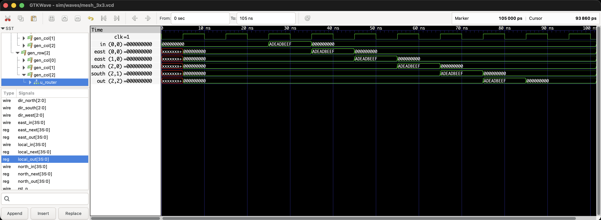

# NoC Router

A 3×3 mesh in SystemVerilog. Each router uses XY routing and holds a packet for one clock before forwarding it.

The git tag [`v0.1-xy-mesh`](https://github.com/SABER-MOHAMED/NoC-Router/tree/v0.1-xy-mesh) is this version: the diagonal route below is what `make mesh` runs. Later steps are in [ROADMAP.md](ROADMAP.md).

## Run

```bash
make mesh
make waves-mesh
```

`make mesh` needs Icarus Verilog (`iverilog` and `vvp`). `make waves-mesh` opens the dump in GTKWave.

## The diagonal

The test sends one packet from `(0,0)` to `(2,2)`. Y grows south, so XY walks east, east, then south, south. Four hops, plus one clock in the source router, so the trip takes 5 cycles.



`deadbeef` shows up on one port per clock: in at `(0,0)`, east out of `(0,0)`, east out of `(1,0)`, south out of `(2,0)`, south out of `(2,1)`, then out at `(2,2)`.

## Packet

36 bits: destination Y, destination X, then a 32-bit payload. The all-zero word means idle, so a packet of all zeros is ignored. If two packets want the same output on the same clock, one of them is dropped. Both are still open.
