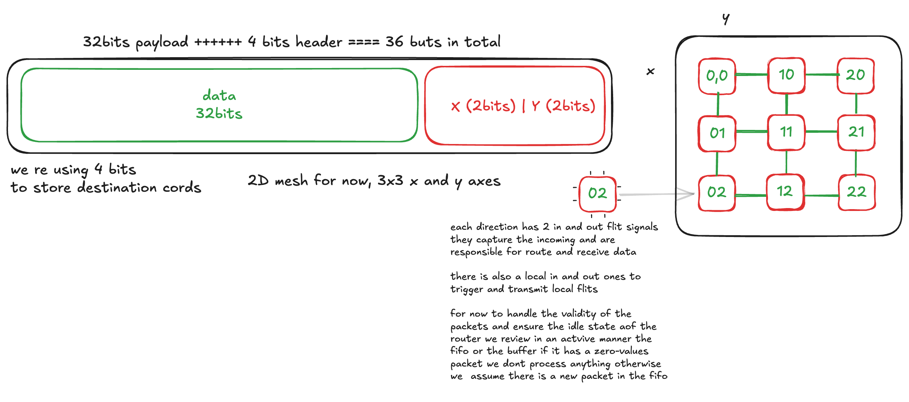

# NoC Router
This is a multi hop, 2d-mesh NoC Simulator written in System verilog.

it simulates how multiple processing units or cores communicate with each other in a chip (many-core architecture).

the project is basically a hardware router that takes incoming data packets, figures out where they need to go (North, South, west  or East) and routes them to the correct output port.

The main goal of the project is to build the router from scratch and understand its components , and how they work together to route packets, we aim to simulate the design correctness using waveform inspection

the project has four main parts:
1. The Package : which contains the global parameters, type definitions, and tasks.
2. The Routing Logic: which is the brain of the router, it decides the next hop direction.
3. The Router: which is the core component of the NoC, it takes incoming data packets, figures out where they need to go (North, South, west  or East) and routes them to the correct output port.
4. The Mesh: which is the network of routers, it simulates how multiple processing units or cores communicate with each other in a chip (many-core architecture).

